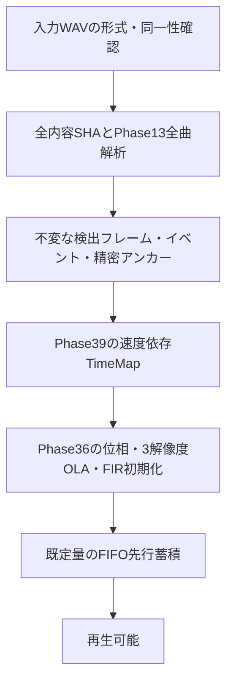

# Phase 55：解析データと確定境界の依存関係

調査基準はPhase 54完成SHA `039592e59cc1a525b495e38d3cedeb6c050792b1`。音質・演算順・公開APIは変更していない。以下の「確定」は、同じ入力の続きを解析しても値が変わらないという意味であり、単に解析関数が戻ったという意味ではない。

TimeMapは入力位置と出力位置の対応表、prefixは先頭から続く領域を指す。OLAは合成窓を重ね足す処理、FIRは帯域を分けて合成する有限長フィルター、safe-densityは合成窓の重なりを安全に保つ制御である。以下では既存コードとの対応のため識別子も併記する。

## 1. 再生開始までの依存

`PlaybackEngine::prepareLocked()`（`src/playback/PlaybackEngine.cpp:38`）は`PlaybackAnalysisCache::acquire()`の完了後にpipelineを作りReadyへ進む。`play()`はworker起動と先行蓄積を待つ。pipelineのworkerは全解析から`Phase39TimeMap`と合成用のreset/strength配列を構築する。したがってprepareを別スレッドから呼ぶだけでは、この直列依存は短くならない。

キャッシュhitなら全内容ハッシュと解析を省く。初回missでは内容ハッシュも全ファイルを読む。解析だけの段階化に成功しても、現行の厳格な入力識別の待ちは別に残る。hashを省略した仮想経路と現行APIの性能を混同しない。

## 2. 検出フレーム

`Phase13StreamingEngine.cpp:66`の解析はMidだけで行う。FFT長4,096、入力ホップH=1,024、左右padding=2,048。フレームkの実サンプル参照範囲は`[kH−2048, kH+2048)`（先頭・真のEOSでは0埋め）。stereoの左右スペクトルのnormを順番どおり加算してsqrtし、1本の共有検出列へ渡す。

`TransientDetector`の依存は次のとおり。

| 値 | 必要な情報 | 確定条件 |
| --- | --- | --- |
| flux / logEnergy / previousLogEnergy | 現在と直前のlogスペクトル。前回logはfloatへ丸めて保存 | 実FFT窓をすべて取得し、同じ演算順・履歴を維持 |
| threshold / strength | 過去12フレームのfluxの中央値・中央値からの絶対偏差 | 現在までの完全な窓がある。曲全体の正規化はない |
| detected | 直前・次のfluxとの局所最大、立上がり、強度、過去の検出から2フレームのcooldown | 次のフレームまでの窓と検出履歴がある |
| resetApplied[k] | detected[k]に加え、lookback=1で次フレームの検出がkへ戻る可能性 | 少なくともk+2までの窓と履歴がある |

解析先頭を毎チャンク0初期化しては一致しない。STFTの絶対位置、前回float logスペクトル、前回double logEnergy、12フレームの履歴、cooldownのlastDetectedを継続する必要がある。生PCMの重複だけでは状態の代替にならない。

`finalize()`（`TransientDetector.cpp:42`）は現在の全配列を先頭から走査するオフラインAPIで、最後の要素を「次がない局所最大」として扱う。さらに既存の`detected/resetApplied`をfalseへ戻さない。**push→finalize→push→finalizeを増分APIとして使うと古いtrueが残る。** 専用反例テストで確認した。既存の一度だけ呼ぶ方式は変更しない。

長さLに対し、解析配列長は`ceil((L+2048)/1024)+1`、active数はL≥2048なら`floor((L−2048)/1024)+1`。active外の人工tailをイベント候補へ含めない。部分WAVの末尾を本来のEOSとして処理した配列の全体は、全曲解析の確定prefixではない。実験では非EOS時に`active−2`フレームだけを検出結果全フィールドの保守的比較範囲にした。

## 3. イベント統合は固定の先読み長だけでは終わらない

`TransientEventMap::consolidateEvents()`（`TransientEventMap.cpp:9`）は`detected`ではなくflux/threshold/strength/energyから候補を選ぶ。条件はflux>threshold、strength≥0.25、energy>前回×1.02。前候補との距離が4以内、または12以内かつ現在energy<既存peakの20%なら同じイベントへ統合する。強いfluxが来れば既存peakが後ろへ移る。endも伸びる。

12は**直近endから次の候補までの距離**で、onsetからイベント全体の最大長ではない。4フレームごとの候補列は任意の長さまで同じイベントを延長できる。16/128/4,096フレームまで延びる列の反例を専用テストに保存した。したがって「12フレーム先まで解析したから12フレーム前を常に公開可能」という規則は成立しない。

一方、候補を確実に計算済みのフレーム範囲で、イベントend=eのあと`e+1...e+12`に候補がないと確認できれば、そのイベントのonset/peak/end/strengthは閉じる。実験の保守的な判定は`active > e+12`。その後のイベントはそのendへ戻って統合されない。連鎖中の最後のイベントは公開しない。既定の`preserveAttackRegion=false`を維持し、選択的resetの別設定へ拡張していない。

## 4. 精密アンカー

`TransientAnchorLocator::locate()`（`TransientAnchor.cpp:19`）は固定peak pについて`[max(0,pH−H), min(L,pH+2H))`の3,072サンプルを読む。左右の二乗和、エネルギー総和、最大値、最大付近±4サンプルを除くrunner-up、crest factor、内点条件を使う。Phase13の精密設定はcrest≥20、peak-to-runner-up≥3、内点必須。

固定peakと窓全体があれば後続の無関係な音は値を変えない。しかし未確定イベントのpeakが動けば、窓、confidence、offsetも変わる。チャンク末尾で窓を切ると総和・crest・内点判定が変わる。イベントを閉じ、必要な入力サンプルを保持してから確定する。既定解析では候補を完全FFT窓で判定する条件がアンカーの未来2Hも覆う。

## 5. TimeMap：解析の完了とPCM不変性の違い

`Phase39TimeMap.cpp:11`の固定map生成は速度vに対しratio=1/vを用いる。

### v<1（ratio>1）：イベント間の伸張補償

`TransientEventMap::buildTimeline()`（136行目）は0、各peak、末尾nodeを区間の両端とし、各区間で保護重みを合計する。区間長、重み総和、精密アンカー補正の両端差からbaselineとdepthを計算し、全ホップへ配る。末尾nodeも仮のアンカーになる。

次のpeakやそのoffsetが変わると、その区間の**先頭ホップから**変わり得る。曲長が既知でも次のイベントは既知にならない。等しい全配列長で未来の最初のpeakだけを500→1,000へ変える反例ではnode1が変化した。最初のpeak=10を両者に入れると0〜10は一致するが、その後の未閉鎖区間は変わる。サンプル丸めによって最初の数nodeだけ偶然同じ場合もあるため、最初の一致だけを根拠にしない。

確定した両端peakに挟まれ、後続のイベントのpre-rollも入らない区間は同じ順で計算可能。既定pre-roll=2、イベント間の閉鎖条件から、閉じたイベントより先の新イベントは既確定区間へ重みを足さない。先頭からのdouble位置加算順も保存し、区間開始で理想値へ再丸めしてはならない。

### v>1（ratio<1）：Phase37の圧縮補償

`phase37Map()`（`Phase37HighSpeedMap.cpp:18`）はイベントpeakの前3〜後6付近に保護重みを作る。隣接アンカーの理想出力位置、区間長、重み総和からbaseline/depthと密度のfallbackを決める。ここでも右端のイベントが必要である。末尾区間は実EOSを確定するまで仮置きできない。Phase37は区間末尾を明示的に丸めた目標値へ合わせるので、伸張側と数値手順を共通化しない。

### v=1

固定座標は等倍なので入力依存の補償差はない。ただしPhase39/36の再生は解析と合成状態を使用する。未知イベントによる位相reset、OLA/FIRの未来寄与まで含むPCMを、map一致だけで保証できない。実験でも等倍mapが一致した部分WAVの末尾付近でPCM差を観測した。等倍だけ無断で別の素通し経路へ変更しない。

### 出力長と速度変更

固定速度の目標フレーム数`round(L/v)`はWAVヘッダーのLだけで分かる。これは局所的なホップ・位相・PCMの確定を意味しない。最終解析nodeはpadding込みでEOSより先にあり、目標PCM長とも異なる。

`Phase39TimeMap::submit()`は新速度の固定map、保護区間と4区間以上のsafe run、公開済み位置、遷移の完了位置を使う。L2は保護中のホップを保持する。未確定領域へ遷移が入る場合は要求を保留し、全曲解析へ戻す必要がある。単に部分mapを後で差し替えると、既に処理した位相・窓・FIRと整合しない。

## 6. 所有権と合成状態

`Phase13TransientAnalysis`は非公開の共有不変データで、入力長、検出配列、events、anchorsを持つ。`Phase13PreparedFile`は固定速度mapと出力長を別に所有する。既存のクラスには解析済み境界を更新するAPIがない。Phase54の解析leaseは同一性確認済みFDの寿命を保持し、同じ入力の並行要求は全解析完了を共有する。

Phase36はLow/Mid/Highの位相・前回入力位置・stereo状態、OLAの信号と重み、2本のFIRの変換ブロックと蓄積位置を継続する。Low窓は8,192、Mid4,096、High1,024。FIRは1,024未来サンプルだけでなく、FFT変換するブロック全体の入力を先に生成する。**map nodeが確定した地点まで、そのままPCMを公開してよいわけではない。** 各解像度の次入力/処理済み入力/OLA確定境界とFIR未処理sourceを含む合成境界が必要である。

Phase55の16,384出力フレームの切り戻しは比較用の保守的cropであり、全条件の最小先読みの証明ではない。FIFO容量・先行量の変更にも使わない。実時間でsnapshotを継ぎ足す合成と速度変更は未実装・未保証のまま保持する。
