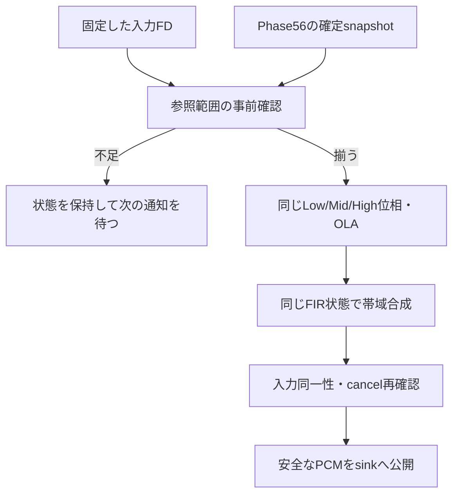

# Phase 57：増分DSP合成の設計

## 対象と既存品質

既知のWAVの全曲解析が終わる前に、Phase56の確定データだけから固定速度のPCMを生成する、オフライン専用の実験である。`ProgressiveSynthesisEngine`は製品PlaybackEngineへ接続しない。Experimental 3500、位相・左右共有ピークと位相差、3解像度、アンカー補償、OLA、FIRの既存算術を維持する。音程は従来の位相ボコーダーで保ち、等倍も同じ合成を通る。

TimeMapは入力と出力の時間対応表。OLAは窓ごとの合成信号と重みを重ねて正規化する処理、FIRは帯域を分けて足し合わせる有限長フィルターである。解析が終わった位置、対応表が確定した位置、PCMが安全な位置を区別する。

## 共通化した内部部品

基準SHAは`ec087019626d9ff0d9f157245729b74ddb6847d7`。変更前のPhase36/39へリンクした`phase57_reference`を先にビルドし、`build/phase57_frozen/reference`へ固定した。以後のPCM参照はこの独立実行ファイルで生成する。

Phase36の内部`ResolutionStream`、`LiveStreamingFIR`、検出データ、計測・診断の補助処理を`Phase36SynthesisCore.h`へ移した。従来の`Phase36StreamingSpeedEngine.cpp`は同じ部品を使い、従来の全曲処理ループを維持する。新エンジンも同じSTFT・位相処理・ステレオ補正・OLA・FIRを使う。DSP品質アルゴリズムを別実装として複製していない。

従来の検出データは引き続き完成TimeMapを参照する。実験側だけが`ProgressiveAccess`を与え、共有不変snapshotのnodeと閉鎖eventを読む。共通部品には読取り可能性の事前照会とFIR参照範囲の照会を追加した。既存製品ライブラリからPhase57実験ライブラリへの依存は追加しない。共有部品の共通化による回帰は、固定した変更前PCMと既存Goldenで別に検査する。

## 継続する状態

| 解像度 | FFT窓 | 通常の解析hop | padding |
| --- | ---: | ---: | ---: |
| Low | 8,192 | 2,048 | 4,096 |
| Mid | 4,096 | 1,024 | 2,048 |
| High | 1,024 | 256 | 512 |

0.50未満は既存規則どおり解析hopを半分にする。固定速度では開始時の密度を継続する。動的L1/L2・safe-density計画や速度履歴は今回接続しない。

各解像度は絶対入力位置、前回入力位置、前回出力開始位置、次のevent番号、STFT、位相ボコーダーの前回位相・蓄積位相・振幅・ピークの所有関係、ステレオの前回位相差と有効フラグを保持する。チャンネルごとのOLAの信号・窓重み・読取り位置と、出力キャッシュも同じインスタンスに残る。

アンカーはPhase56で閉鎖時に確定し、TimeMapへ反映済み。resetは各解像度の現在入力位置と次入力位置の中点より**厳密に前**のeventへ適用する。中点と一致したeventは次のフレームに属する。元の比較・強度の最大値・左右の処理順を保持する。Experimental 3500のPhase36合成はこのevent列を使い、検出フレームのresetフラグへ独自に置き換えない。

FIRはLow−Mid、Mid−Highの差分をそれぞれ処理する。FFT長4,096、Low側は2,049 taps・中心1,024・入力ブロック2,048、High側は513 taps・中心256・入力ブロック3,584。周波数応答、次ブロック先頭、畳込み結果の蓄積ring、次に返す出力位置を継続する。チャンクごとのflushはない。

## PCM公開の必要条件

1回の`advance`は最大2,048出力フレームを扱う。生成前に、ブロック末尾までにFIRが必要とする**変換ブロック全体**のsource末尾を求める。中心の先読みだけで済ませない。Low/Mid/Highそれぞれに必要な最大の出力位置を伝え、位相・OLAを変更せず、次の入力フレームからの処理予定を調べる。

入力位置p、窓のpadding P、要求する出力位置yについて、次を満たすフレームだけを処理可能とする。

- 非EOSでは`p+P <= receivedInputFrames`。窓の右側を仮の0で補わない。
- 非EOSでは`floor(p/1024)+1 < mapThroughNode`。対応表の補間に必要な両nodeがある。未確定末尾を外挿しない。
- resetの判定中点が最後の確定map nodeの入力位置以下。未知の将来eventが判定範囲へ入らない。
- `llround(map(p))`が`y+P`以下ならそのフレームも必要。次の未処理フレームの出力開始が`y+P`より後になるまで確認する。

これにより、対象OLAサンプルへ寄与する窓がすべて計算され、今後の窓がそのサンプルへ加算されないことを確認できる。合成ホップの正値・窓長未満の検査も元のまま残す。

非EOSではFIRが読むsourceの上端を、最後の確定nodeの出力位置以内に制限する。この位置は、既知の入力全長に対応する最終出力長の下限である。末尾の不完全なFIRブロックを仮に作らない。EOSまで最終PCM長は決めず、作業用の暫定上端を内部に置き、EOS後に**完成TimeMapの入力全長位置**から従来と同じ式で求める。単に`round(L/speed)`で置き換えない。

全解像度とFIRの事前確認が通った後だけ、既存部品の実処理を進める。混合はHigh、Low側FIR加算、High側FIR加算の元のfloat演算順。最後に入力同一性とキャンセルを再確認し、成功したブロックだけsinkへ渡す。固定16,384フレームの切戻しや、固定秒数の余裕は安全境界の根拠に使わない。

## 内部APIと待機

`Phase57ProgressiveSynthesis.h`の操作は次のとおり。

- コンストラクター：固定した入力FDのパス、要求速度、入力世代、入力検証関数、作業領域予算を受け取る。
- `supplySnapshot`：世代・要求速度・各配列の確定数・境界の単調増加を検査し、最新の共有所有権1個を保持する。正常EOSでは解析入力数とWAV全長の一致も必須。
- `advance(sink)`：最大1出力ブロック。`Produced`、`NeedsMoreInput`、`NeedsMoreAnalysis`、`Finished`、`Cancelled`、`Failed`を返す。
- `cancel`：別スレッドから要求可能。正常完了済みEOSは変更しない。
- `fail`：producer側で正常継続できなくなったときの失敗通知。
- `frontier`：各境界の診断。producerまたは停止後の呼出し専用。

producerは1本に直列化する。待機中の再呼出しで位相・OLA・FIRは動かない。解析待ちでmap境界が増えていなければ事前照会も繰り返さない。入力待ちは受信量が増えるまで同じ状態を返す。

`frontier`は受信量、検出確定数、閉鎖event数、map node数、各解像度の次入力/最後の入力/参照可能入力範囲/OLA読取り境界、FIR source位置と確定出力位置、生成済み/公開済みPCMを分ける。Throughは末尾を含まない要素数。各解像度のOLA位置はpaddingを含む内部座標であり、PCM座標と直接比較しない。

## 161速度とpreset

速度は400000〜2000000を10000刻みの整数で指定する。各sessionのPhase56解析へは**その1速度だけ**を要求する。速度間のmap/PCM補間はしない。snapshotからnodeを読む式とllroundはPhase39のまま。16要素の小さな座標キャッシュは既に確定した同一位置の値を再利用するだけで、別速度・別位置の近似を作らない。

Candidate/Baselineの初期固定速度のmapとDSP設定は共通であり、L2/Cの差が現れる途中の速度変更は今回対象外。試験は変更前バイナリの両presetのPCMへ別々に照合する。先行量相当の時刻はCandidate16,384、Baseline12,288フレームで別に測る。DSP生成ブロックは双方2,048。実FIFOやデバイスへは接続しない。

## 所有権・メモリ・入力寿命

最新snapshotの共有所有権1個と、継続DSP状態をengineが所有する。補給時に配列全体をコピーしない。古いsnapshotはengineから解放する。外部readerによる保持にはPhase56の所有容量上限が引き続き適用される。

DSPの配列は窓サイズ・チャンネル数で決まり、曲長に比例したPCM配列をengineへ持たせない。固定作業領域の予算見積りは保守的に8MiBとし、既定の予算は16MiB、見積り未満の設定は構築時に拒否する。8MiBを一括確保する実装ではなく、標準ライブラリやAccelerateの非公開領域を含む厳密なallocator上限でもない。実測Peak RSS、Phase56所有容量、DSP作業領域の予算見積りを別々に報告する。解析の内部特徴列とmapは曲長に比例する。

sinkへ渡すPCMは呼出し中だけ有効な借用配列。受け取る側がコピーまたは消費し、engineのバッファのポインターを次のadvanceまで保持しない。公開済みデータへengineが後から書き戻すAPIはない。sink失敗や公開直前のcancelでは生成量だけが進む場合があり、公開量は進めず、そのsessionを再開しない。

`PinnedInput`は元パスとFDの同一性を確認し、DSPの3 readerはそのFDをそれぞれ位置非依存のpreadで読む。入力所有者はengineと検証関数より長く生存させる。engineを先に破棄し、その後に解析・入力を解放する。ファイル置換・切詰め・アクセス失効・読取り失敗は失敗となる。実ファイルのread cacheは先読みするが、FFTへ渡す論理窓は確定済み入力範囲だけである。

現実装は全長と形式が既知で、処理中に書き換えないWAV用。ネットワークや到着中の生PCMを保存する入力ringは実装していない。検証関数・ファイルI/O・確保・共有所有権操作を音声callbackで実行してはいけない。

## EOSと失敗

真のEOS snapshotだけで末尾padding、最後のイベント、末尾map、FIRの最後の短いブロックを有効にする。Low/Mid/Highは元の終了フレームまで処理し、最終出力長で打ち切る。部分WAVの終了、チャンク末尾、入力不足をEOSにしない。重複したEOS補給は拒否する。

解析失敗、世代違い、境界の逆行、DSP例外、sink例外は失敗。cancelと失敗はFinishedへ変換しない。実I/O失敗が計算途中に起きた場合は内部状態を廃棄し、同じsessionを再開しない。不足を補う0埋めで成功扱いにしない。正常完了後のcancelは完了を維持する。

閉鎖eventが得られない長い連鎖や無候補区間では安全なmapが増えず、PCMをEOSまで公開できない。これは保護を維持した待機である。一方で通常の素材を一律にEOS待ちにしない。実際の早期公開量と時刻はREPORTへ記録する。
