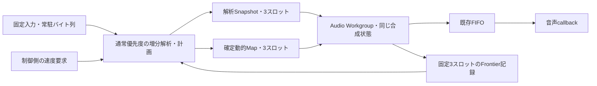

# Phase 59：増分エンジンの動的速度変更

## 独立した経路

基準は `bb22efcbd27f999e8ffe85bbe3f03e20895be3f2`。`phase58::Configuration::dynamicTransitions=true` で研究経路を明示選択する。既存PlaybackEngine、既定設定、SwiftUI、Merodoaは切り替えない。正式速度は400000〜2000000、10000刻みの161値。Phase39自体の小数6桁の速度識別は維持する。

TimeMapは入力の音声位置を出力位置へ対応させる表、Snapshotは版を付けた不変の解析データ、Frontierは現在の処理境界を示す。FIFOは生成順で音声を渡す有限バッファ、EOSは曲の終端を表す。

解析と計画は同じ通常優先度の解析・制御スレッドで行う。実時間DSPスレッドには、イベント走査、TimeMap構築、共有所有権の取得・破棄、履歴の再構築を移さない。計画にCPUを使った間も、DSPは現在の確定座標で合成できる。

FIFO容量16384、生成2048、先行量Candidate16384/Baseline12288、出力ゲイン0.5を維持する。入力常駐、Ready後の実時間昇格、Pause時の降格、Resume時の再昇格、終了時の離脱・通常スケジューリング復元もPhase58 Fixを使う。

## 確定した座標だけで計画する

`ProgressiveTransitionPlanner` はPhase56の閉鎖イベントと精密アンカーから、必要な速度の座標を `MapPrefixBuilder` で直接計算する。現在速度と目標速度の固定Mapを任意位置でつなぐ方式や、161列間の補間ではない。解析のFFTを再実行しない。

`Phase39TimeMap` に追加した入口は、実際の確定prefixと同じ長さの目標prefixを受け取る。未確定末尾を全曲として外挿したり、未閉鎖イベントを「イベントなし」とする入口ではない。旧全曲コンストラクターと新入口は、同じ保護区間索引・同じ `submit` を使う。50ms、smoothstep、丸め、L2の保護中ホップ保持、Cのsafe elapsedは変更しない。

非EOSのprefixは最後の閉鎖イベントのpeakまでで、その末尾は既知イベントの保護域内にある。将来イベントの開始前保護や「4 Mid以上の安全区間」の判定が未確定な末尾を使って、遷移を成立させない。安全区間を見つけられない、rampがprefix内で終わらない、密度検査の未来範囲が足りない場合は `PendingAnalysis` とする。完成解析後の確定的なNoSafeInterval/Truncatedとは区別する。

safe-densityは既存 `chooseSafeDensitySwitch` を呼ぶ。そのLow窓の予測は切替候補から4×8192入力サンプルまで読むため、非EOSではその全域が確定prefix内にある候補だけを調べる。未確定末尾を読めるように制限を緩めない。

解析が伸びたときは、確定済みの速度要求履歴を新しいprefixへ同じPhase39で再現する。過去の適用位置・ramp終点・完了位置と、既に確定した全Map nodeが変わらないことを通常側で検査する。公開済みPCMを再合成しない。

## Frontierと適用の取引

Frontierには、生成・公開位置、3解像度の次/最後の入力、OLAの確定位置、FIRの次source、実際の直近24フレーム、OLA重みを入れる。解析版と動的Map版は別々に扱う。

1. 通常側は最新Frontierと現在の動的履歴から、既存Phase39/Phase50/Phase42で候補を作る。
2. Candidateは精密L1とL2、Baselineは既存のlegacy境界とCを使う。
3. 候補は不変Mapとして公開する。通常側はまだ適用確認を待つ。
4. 実時間側はMapの基底版、入力世代、確定範囲、処理済み両node、直近フレーム、現在のPhase50境界、密度切替位置を有界に再確認する。
5. 古いFrontierによる候補は採用しない。通常側が取引を戻し、新しいFrontierで再計画する。
6. 採用確認後だけ、その要求をAppliedとし、旧計画の所有権を通常側で解放する。

Map全体のコピーや全過去nodeの走査は実時間側で行わない。通常側が算出した最初の変更nodeまでの不変prefixを、基底版と処理境界で確認する。実時間側の検査は3解像度・直近72フレーム・最大512密度切替に有界。位相、Phase Locking、Stereo Coherence、OLA、FIR、reset状態を作り直さず、同じPhase57インスタンスを続ける。位置キャッシュだけを無効化する。

非EOSの最終出力長は未知のままとし、確定prefixの先へPCMを生成しない。完成Mapを受け取った時点で全長を確定する。変更のない固定経路の製品長規則と、動的変更後の既存Mapによる全長規則を区別する。

## 要求状態と寿命

低水準の状態・結果は既存 `Phase39RequestState` / `Phase39RequestResult` / `Phase39Outcome` を使用する。操作側は既存PlaybackEngineと同じPending、Submitted、Applied、Completed、Replaced、Duplicate、Rejected、Cancelledの意味を持つ。

保留は最新1件、送信済みの実行要求は別の1件。保留の置換で適用済み計画を変更しない。AppliedはDSPが計画を受け入れたこと、CompletedはPCM消費位置が完了座標を越え、3解像度の密度切替処理も終わったことを意味する。音響的に耳へ届いた時刻ではない。

session・input generationの不一致、不正な1%外の速度、停止後の要求を拒否する。Stop/失敗/EOSで未完了要求を終端へ移す。停止時は両workerをjoinしてから最後の適用確認を回収し、実際に適用された計画を取り落とさずにCancelを記録する。

## 所有量と予算

- 解析の借用メールボックスは従来の最大3スロット。解析セッションの最新所有権と通常計画側の1個のSnapshot参照も含め、Phase56の所有容量制限で管理する。無制限のSnapshot列は作らない。
- 動的Mapも最大3スロット。通常側の最新・適用待ち・取引前参照は有界で、実時間側は参照数を増減しない。
- 固定Map cacheは既存Phase39の最大5列。全161列を常駐させない。
- 研究経路の適用履歴は512件、操作監査は4096件を上限とする。上限到達はLimitReachedで新要求を拒否し、現在速度のPCMを変更しない。旧製品の4096件の履歴循環保存とは異なる研究上の制限である。
- DSP状態、入力常駐量、Snapshot計数容量、Map座標容量の見積り、検証用PCM領域、プロセスPeak RSSを分けて記録する。Map容量の見積りを厳密なallocator全量とはしない。

実測値と未達事項は [REPORT](../results/phase59/REPORT.md) / [VERDICT](../results/phase59/VERDICT.json) を参照する。

高水準APIのAcceptedは最新1件のPending受付である。低水準Phase39への送信がAcceptedだったと読み替えない。遷移中の低水準Busyと、既存Phase52と同様の保留受付を分ける。512適用履歴の上限では、低水準Invalidと高水準LimitReachedの理由を併記する。計画公開時の確保失敗は取引を戻す。worker失敗では取消状態を先に確定してから失敗を公開し、遅れて戻った適用通知で終端操作を復活させない。

arm64の実測構造体サイズは `STRUCT_LAYOUT.json` に保存した。Frontier受渡しの固定領域4160bytes、操作監査の予約要素2064×4096＝8454144bytes、適用履歴の予約要素合計86016bytesである。イベント・Map座標・allocator管理領域を含む総所有量とは区別する。最大の実行要求は1、保留は1であり、4096件は実行待ちキューの長さではない。
