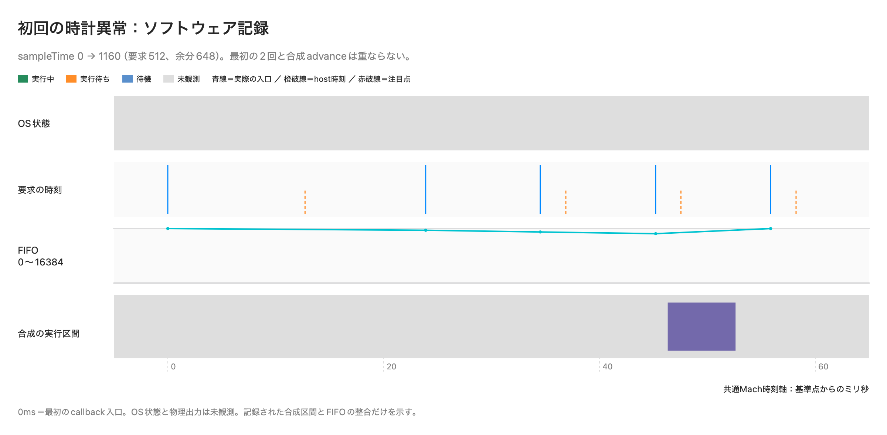
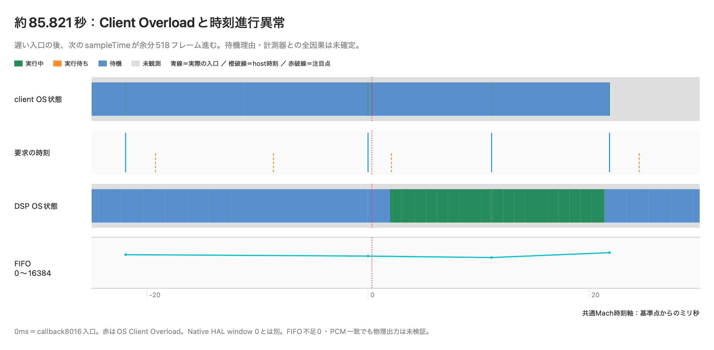

# Phase 59 Fix 2：SourceNode / HALの時計調査

## 結論と判定範囲

初回の時計不連続と途中再生のClient Overloadについて、根本原因は未特定である。初回を除外せず、元の診断閾値を維持した。反復成功、callback本体の短さ、PCM完全一致のいずれも、過去のFAILを取り消す根拠にはしていない。最終件数は[REPORT](../results/phase59_fix2/REPORT.md)と各実行のmanifestを参照する。

依頼書にある途中再生の「余分6フレーム」は原本と異なる。callback 8016→8017では sampleTime差989、直前の要求471で、余分な進行は **518フレーム**。44.1kHz素材のSourceNode時刻と48kHz装置時刻を混同しない。

## A〜Fの構成

|構成|信号供給|調査結果の保存先|
|---|---|---|
|A|識別可能な固定Float32 PCMをSourceNodeが直接コピー。DSP・FIFO・供給workerなし|`minimal_initial` / `minimal_long`|
|B|同じ事前生成PCMを通常workerと既存FIFOから供給|同上|
|C|Phase58 Fix固定速度。最終候補の診断専用実行体|`startup_cde` / `startup_cde_final`|
|D|Phase59動的経路。速度変更要求ファイルは空|同上、`trace_dynamic_no_request`|
|E|Phase59動的経路。元の速度変更操作列|`startup_cde` / `startup_cde_final`|
|F|旧製品原本、Phase59前、現行診断版を別SHAで比較|`legacy_investigation` / `legacy_final`|

M1、macOS 26.6.2、内蔵出力ID72、装置48kHz/512、Release arm64、Source→mainMixer→output、gain 0.5。BのFIFO容量16384、Candidate先行16384 / Baseline12288、生成2048を維持した。Fの正式比較は以前と同じ44.1kHz入力で、Source側に470/471要求が現れる。追加の`legacy_same_rate`は48kHz Float32 stereo入力を無変換で12秒へ繰り返し、Seek 6秒の操作条件を保った。長さの違いは残るので、完全に同一条件のA〜F比較とは呼ばない。

A/Bの初期60試験と長尺3試験で初回時計異常は再現しなかった。この結果からDSPを原因と決めることも、HALを正常と決めることもできない。追加のWorkgroup実験では、両条件に同じ待機adapterを作り、実時間昇格・参加だけを切り替えた。通常workerのBとは別実験として集計する。

## 計測の境界

独立再現器はsampleTime、raw hostTime、flags、rateScalar、実際の要求数、callback入口/出口Mach ticks、thread ID、FIFO読書cursor、PCM論理位置を有界配列に保存する。配列は再生前にwrite-touchし、停止・worker join・callback静止後に書き出す。callback内のファイルI/O、mutex、メモリ確保、重いObjective-C制御、トレース制御は追加しない。

`engine_state_id`は準備済みの制御イベントから出力時に対応付ける。0=設定、1=prepare完了、2=start呼出中、3=start復帰後、4=stop呼出中、5=停止後。AVAudioEngine内部の私有状態を取得した値ではない。初期版の固定IDと、最終版の対応付けをmanifestのSHAで区別する。

FIFOのread/write cursorは別々のatomic loadである。並行する供給を含むため、同時の一括snapshotとして差分を断定しない。要求数、受信数、累積論理位置、公開履歴を併用する。無効flagsは計算に使わず、測定不良として別に数える。

Aの直接PCMにはFIFOがなく、同名のcursor列はPCM配列の論理位置を示す。Bの実FIFO cursorと区別する。rateScalarはflagsの有効bitがある記録だけ集計し、旧原本で保存されていない値を1として補わない。

## Appleの契約とA〜Hの区別

[SourceNode render block](https://developer.apple.com/documentation/avfaudio/avaudiosourcenoderenderblock)のtimestampはHALのrender時刻、frameCountは今回要求された数である。[AudioTimeStamp flags](https://developer.apple.com/documentation/coreaudiotypes/audiotimestamp/mflags)は有効なフィールドを指定する。sampleTimeの差だけで返したPCM量を推定しない。rateScalarの有効性と実測値も独立に記録した。

|事象|判定方法と現在の限界|
|---|---|
|A sampleだけ飛ぶ|有効flags、同一session/epochでhostとの差を照合する|
|B hostだけ飛ぶ|sample差・実入口Mach差と分ける|
|C host/sampleが整合して飛ぶ|過去初回異常・旧製品初回で観測。正当な切替との証明はない|
|D 要求累計とsample進行が違う|過去初回・途中異常で成立。返却量が増えたことを意味しない|
|E 呼出しが遅い/欠ける|入口時刻とOS wake/IOProcで判断。HAL timestamp自体の差とは別|
|F PCM論理位置の欠落/重複|PCM生ビット・長さ・順序、供給/消費cursorで検証。旧FIFO不足は別指標|
|G 装置/OSのoverload|OS Client Overloadとコンソールを保存。Native HAL window数で代用しない|
|H 可聴の無音/不連続|独立ループバックを実施しておらず未検証。CoreAudio装置一覧は内蔵マイク/スピーカーのみで、独立測定経路は未構成|

[AppleのInstruments音声解析](https://developer.apple.com/documentation/audiotoolbox/analyzing-audio-performance-with-instruments)では過負荷、時計不連続、再対応付けのイベントを区別する。今回の個別FAILに正当な時計切替があったと説明できるOS証拠は得られていない。

## 初回callbackのOS観測

`xctrace record --launch`、`--all-processes --notify-tracing-started`を正式なヘルプで確認した。単体Aではtrace epochがprocess entryより前で、285/285 callback本体と最初の3回を観測できた。Dも113/113 callback本体、28/28実時間合成区間を直接照合できた。これらは異常が起きなかった短尺試験の証拠であり、過去FAILのOS状態を埋めるものではない。

出力AudioUnitのpre/post通知とも直接照合した。Aは285/285、Dは113/113でhost時刻が一意に一致し、Source本体はその通知窓の内側、sampleTimeと要求フレーム数も同じだった。DのAU側rateScalarは未保存として残す。`OUTPUT_AUDIOUNIT_REVIEW.json`参照。これは48kHz同士のAPI時刻対応であり、装置DACや物理音声を測定した結果ではない。

旧製品のlaunch記録と5回目の通知同期記録では、最初のcallbackがtrace epoch以前になった。通知受領と実際のkernel記録開始が同時とは限らない。Python親はRosetta側のtimebase 1/1、arm64 Native/traceは125/3だった。親raw ticksを125/3と誤変換しない。6回目は同じ容量上限内で通知後3秒待ってから自分の音声子プロセスを起動する。実際のcoverageで判定し、成功を予定だけで認定しない。

6回目の実測では、先頭active callbackはtrace epochの1.520994666秒後だった。時間範囲には入ったが、先頭3回に一意なIOProc対応がなく未観測扱いとした。819 callback中371回、218公開周期中98周期がOS既知。残る448 callback / 120周期を正常で補完しない。今回の旧製品CSVにはcallback thread IDがなく、IOProc対応のない窓を別threadへ推定接続しない。次の計測ではFのcallback thread IDとIOProc表の取得開始も直接対応付ける必要がある。記録は容量予算内の6回で終了した。

旧製品Fの`callbacks_*.csv`はrunning中の記録であり、inactive時の呼出しを全件記録したものではない。表の「最初3回」はその記録の先頭を指す。Aは全呼出しを記録する。Dでは`initial_render_entries.csv`の最初3回がactiveで、`callbacks.csv`の先頭と同じ入口時刻だったことを別に照合した。

最終C/D/Eの各112 callbackは、保存済みのprepare/start制御時刻で再構成した状態IDと全件一致した（ID3、mismatch0）。初期D traceのID1はnominal値なので、実際にprepare直後だったという意味には使わない。`ENGINE_STATE_REVIEW.json`に区別を保存した。

解析の再点検で、Seek中の未公開profileと重複profileを観測済みworker周期として数える誤りを修正した。旧出力を残し、`LEGACY_TRACE_ANALYSIS_*_reviewed.json`を最終集計に使う。未知区間を正常なRunningで補間しない。

## 過去の初回異常と合成区間の分離

Phase59 Fix最終動的normal case000はsample 0→1160、要求512、余分648。Mach↔pipelineの橋渡し誤差は0.75µs。最初の2 callbackの区間はpipeline 2.183644125〜2.207542375秒で、記録された合成advanceは誤差幅を含めて重ならない。次の合成は2.229968334秒、2回目出口の22.425959ms後だった。FIFOは16384→15872、速度変更要求はさらに後である。

これは、その窓の「合成advance実行」や「既にFIFOが尽きていた」を支持しない。解析・計画・制御・Workgroup・OS全体を除外した証明ではない。

## 約85.821秒の別事象

遅い入口は8015→8016の約21.92775msであり、sample進行異常は次の8016→8017に記録されていた。後者の入口差は11.17525ms、host差22.415625ms。時刻を一組ずらして原因を説明しない。

client thread 7094022はcoreaudiodによる起床後、trace 2.951133958〜2.962340791秒に11.206833ms Blocked。dtsecurity PID59471に関連する起床があり、Source8016は約2.962373秒、OS Client Overloadは2.962721秒。隣接する通常のHAL待機も約10.5〜10.65ms Blockedなので、Blocked総時間だけで異常原因とは断定できない。

異常待機窓のsyscallは未取得。近傍はHALC_ProxyIOContext::IOWorkLoopの`semaphore_wait_signal_trap`だが、その名前を欠測窓へ転記しない。dtsecurityの対応thread自体も未観測。Instrumentsや他プロセスを原因と認定する証拠はない。callback中のDecompress Memory 11.792µsとHAL側5.834µsも、11ms待機全体の説明にはならない。

旧トレース原本を以前のmanifestとSHA照合し、APFSコピーからHALサーバー表も追加抽出した。2.962437秒と2.973586秒にEngine86のWrite Safety Violationがあるが、記録値はどちらも0フレームである。これを欠落量や正常出力の証明へ読み替えない。Engine86のzero timestampは約0.33秒ごとに15840フレーム進み、異常を挟む2点でもhost/sample比は約48002.18Hzで、その表には大きな装置anchor切替は現れていない。観測間隔が長く、個別callbackの正当なreanchorを証明する精度ではない。`OLD_HAL_SERVER_REVIEW.json`と`MIDPLAY_HAL_REVIEW.json`に抽出・数値を保存した。

## 未解決事項

初回の実装不具合、HALの正当なreanchor、起動時スケジューリングのどれかは確定していない。途中過負荷との同一原因も未証明。Native本体期限内、FIFO正常、PCM一致でも装置の連続出力は未検証であり、Gate 2は未合格とする。
