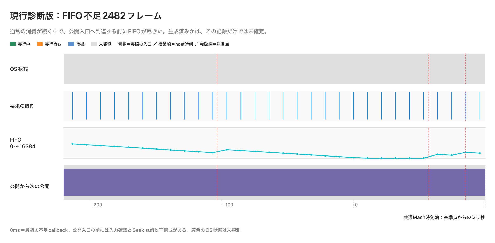

# Phase 59 Fix 2：旧製品FIFO供給停止

## 判定

旧製品のFIFO不足を再現し、生成物を受け取る入口、入力同一性確認、FIFO公開、callback消費を分離して調べた。過去の不足は旧バイナリでも成立しており、Phase59動的実装による新規回帰とは断定できない。一方、現行の最適化済み診断版でも不足を観測したため、既存製品の供給問題は未解決である。最終集計は[REPORT](../results/phase59_fix2/REPORT.md)を参照。

## 保護した比較条件

既知のCandidate1319、Baseline8208、最終Baseline234不足は以前の原本のまま保持した。今回の正式比較は同じ`results/phase31/input/mix.wav`、同じsmoke/EOS操作列、Candidate/Baseline、内蔵出力72、48kHz装置、512、Release arm64。旧Phase58Fix原本、Phase59前の固定実行体、現行診断版を別SHAで実行した。FIFO容量・先行量・生成ブロックは変更していない。

smokeのPlay / Seek / 速度変更 / Pause / Resume / Stop / Stop→Playを`actions.csv`、`seeks.csv`、`control.csv`、session/epoch別callbackと照合する。製品には44.1kHz Source→48kHz装置の変換があり、要求470/471を512と誤比較しない。追加48kHz比較では入力形式差を減らし、素材を12秒へ繰り返して同じSeekを成立させた。新しい素材SHA・生成レシピは`LEGACY_SAME_RATE_INPUT.json`に記録した。

cache hitはsummaryの集計であり、各wakeごとのhit/miss境界を全て取ったものではない。Seekの観測/Ready、session、操作時刻はあるが、上流の解析・計画・PCM生成開始/終了の全段階は未取得。worker周期の開始をOSによる実際のwake時刻と同一視しない。新しいPCM sink入口も生成後に到達する観測点である。

## 初期36試験で観測した3失敗

|試験|観測|説明できる範囲|
|---|---|---|
|旧原本 smoke Candidate|初回sample 0→989、要求471、余分518。PCM一致・不足0|時計と供給は別問題。正当なHAL切替かは未証明|
|旧原本 smoke Baseline|合計8016不足。graph0の131とgraph1の7885|過去の8208/234とは別試験として保持|
|現行診断 smoke Candidate|2482不足、6 callback、session3 / epoch2 / callback226から|最適化済み現行経路でも供給停止が残る|

最初の現行不足は要求470、受信339、FIFO339、read38573→38912、write38912で始まる。その後5 callbackは公開が来るまで受信0だった。直前公開292380416123583ns、次公開292380576869250ns、間隔160.745667ms。次の公開入口は292380576844333nsで、不足callback入口292380519589041nsより後である。

不足部分はrender側の返却バッファでゼロ埋めされる。raw PCMの正確性PASSは生成・受信できたPCMの内容を検証しており、そのゼロ埋めを含む再生時系列や物理音声が連続だったという意味ではない。従ってPCM PASSでもAUDIO_QUALITY FAILを維持する。

直前周期Wall311.779ms / CPU19.524ms、次周期Wall160.727ms / CPU36.679ms。Wall−CPUを、OS記録なしでPreemptedと呼ばない。通常の消費が続いたまま公開間隔が延びたことは確認できるが、入力確認・ファイル待機・DSP・準備・前回後処理のどこに非CPU時間があるかは、この初期記録だけでは確定しない。

## 計測名の解釈を訂正

`pcm_ready_mach_ns`は**publish関数入口**の観測点であり、真のDSP計算終了点ではない。外側のfeedでは、その前に入力identity確認とSeek suffixの処理がある。従って「publish入口が遅い」から「その時刻までPCMが生成されていない」とは言えない。`LEGACY_MARKER_INTERPRETATION.json`を解釈の訂正として追加し、原本を変更していない。

## 最終正式比較の追加FAIL

最終12比較は11/12。旧原本のsmoke Candidateで1290フレーム不足した。session1 / epoch1 / callback127〜129で、要求/受信/FIFOは470/121/121、471/0/0、470/0/0。時計不連続0、測定品質PASS、受信PCM正確性PASSだが、音声品質FAILを維持する。以前の1319不足とはsession/epochも異なる別試験である。旧原本には新しい供給境界・worker履歴がなく、現行診断版のprofileを転記しない。

最終比較のPhase59前と現行診断版は各4/4。同形式48kHzの追加比較は12/12、深い診断の6試験も6/6で不足0だった。深い診断と最終traceの7試験における入力確認の最長実測は0.06975ms。正常な試験で確認が速かったことから、初期2482不足時にも速かったとは判断しない。供給停止の原因は未特定のままとする。

## 別ビルドでの深い観測

`phase59_fix2_deep_legacy.py`は固定候補のコピーを別ディレクトリに構築する。最終候補のDSP、判定、正式回帰を変更しない。各workerに寿命・thread ID・ownerを記録し、以下の境界を有界配列へ保存する。

|kind|境界|
|---|---|
|1/2|worker開始/終了|
|20/21|PCM sink/feed入口/復帰。外側の入力確認より前|
|22/23|外側の入力同一性確認|
|30/31|publish入口/復帰|
|32/33|publish内の入力確認|
|40/41|FIFO待機|
|50/51|FIFO書込み|

各観測関数にも前後Mach ticksを付け、観測自体が遅れた区間を処理本体へ混ぜない。既存の1ms制御ループから自分のworkerのMach状態を標本化し、取得失敗・worker寿命外は無効として残す。RUNNING標本は実行可能な状態を示し、連続CPU実行の証明ではない。WAITING標本だけで待機先は分からない。

PCM入口の完了が不足callbackより前なら「そのPCMは既に生成済み」という正の証拠になる。入口が後なら、入口前にプリエンプトされた可能性もあり、生成未完了と断定しない。OS標本と入力確認範囲が重なっても、具体的なsyscall/stackがなければfstat、VM、他の待機を確定しない。

出力はMacPlaybackEngine破棄後、制御/workerをjoinしてから行う。65536件の容量・drop数・export成功を保存する。全標本を有効と見なさず、`LEGACY_DEEP_ANALYSIS.json`に実際の有効数を記録する。

## OSトレースと旧数学版

旧数学版は最適化前のPhaseLocker/Phase35の5ファイルだけを、現在の診断/制御ソースへ組み合わせた独立ビルドである。元の固定実行体は置換していない。この試験では2918不足、PCM一致・時計PASSだったが、585.747ms / CPU36.819ms等の不足に結び付く周期はOS状態が欠測だった。これを「OSで全てPreemptedと分かった」とは報告しない。

launch方式、通知同期方式とも旧製品workerがXMLに現れない試験がある。再点検後の`*_reviewed.json`は未公開・重複profileを分母から分け、PIDは取得manifestとプロセスログからも照合する。callback/workerの未観測を0フォルト・正常優先度に置き換えない。

## 製品品質への影響

1. DSPが間に合わない、2.生成後の公開前に止まる、3.callbackが予想以上進む、4.OSスケジューリング、5.Seek/速度準備、6.Stop→Play状態混入、7.複合要因、の区別は個々の証拠範囲で行う。旧バイナリにも不足があることは既存問題を支持するが、新経路との独立原因の証明にはならない。

FIFO拡大、先行量増加、閾値緩和、優先度の推測変更で隠す修正は行っていない。製品採用・Merodoa統合は保留し、供給停止時の入力確認/OS待機の観測を次の課題とする。
