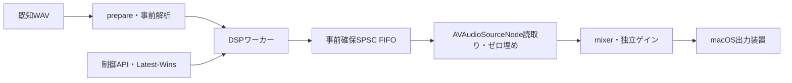

# Phase 52 — Integration Candidate Freeze & macOS Playback Engine Integration

## 結論

**現行の研究用DSPを、アプリから呼び出せるC++ライブラリと独立macOSアダプターへ統合した。Candidateを開発版の暫定標準として利用できる。** 新規GUIは作成していない。既存の正式Experimental 3500、Phase30/36プレイヤー、Phase18/19キャッシュ・シークは変更していない。

再生、Latest-Wins速度操作、pause/resume、stop/restart、EOS、装置変更時の安全停止を実装した。音質アルゴリズムの追加はない。一般公開向け品質保証、全OS停止への耐性、iOS動作の保証は行わない。

主な検証結果：

- アプリAPI経由のGolden再生成 **25/25バイト一致**。
- 独立参照との固定mono/stereo **12/12バイト一致**。任意読み取り64〜4096、pause/resume、再起動、Latest-Wins、Rejected後の復帰、診断OFFでの不足検出を確認。
- 最終コードの決定論的CTest **70/70 PASS**（347.38秒）。EOS排出中の再初期化ガード追加後に全件を再実行した。
- 旧OS期限試験は名前と判定を維持し、別スイートとして **2/2 PASS**。故意の不足・遅刻の実行は個別にFAIL/INVALIDとして検出する。
- 通常の実機保存試行62件のうち **61件で音声・計測・PCM照合PASS**。1件は旧版の停止時partial SHAが未記録で、PCMを証明できずPASSに含めない。修正後の装置変更停止試行で公開済みprefix SHA一致を確認。
- 450ms停止注入2件は、各 **5,120フレーム / 106.667ms** の不足を検出。音声FAIL、障害検出PASSを明確に分離。
- 高CPU負荷のMIX・Drums各3分入力は2/2でEOS・PCM一致・不足0・期限超過0。
- 最終EOSガード試行は機能確認成功・不足0だが、MIX起動時のhost/sample時刻不連続により **MEASUREMENT_QUALITY=FAIL**。安定性PASSへ昇格させない。

## 1. 固定した構成

| 項目 | Candidate | Baseline |
|---|---|---|
| 速度 | 0.40〜2.00、小数6桁のキー | 同左 |
| 合成コア | Experimental 3500、Phase37高速B、Phase42 safe-density | 同左 |
| TimeMap | Phase40 C + Phase50 L1 + Phase51 L2 | Phase40 C、L1/L2無効 |
| FIFO容量 | 16,384 | 16,384 |
| 先行上限 | 16,384 | 12,288 |
| 生成ブロック | 2,048 | 2,048 |
| QoS | 継承 | 継承 |
| Busy中の要求 | 最新1件を保留 | 同左 |

設定は `Configuration::candidate()` / `baseline()` で指定し、`dspOptions()` から解決済みのTimeMap方式・L1・safe-density・FIFO等を取得する。実行中の方式変更は禁止し、停止後のprepareで切り戻す。速度1.00も位相ボコーダ経路で、unity bypassとの切替は追加していない。

## 2. ライブラリ/API

- `src/playback/PlaybackEngine.h/.cpp`：AppleオーディオAPIを呼ばないC++再生・要求制御層。
- `src/platform/macos/MacPlaybackEngine.h/.mm`：AVAudioEngine、SourceNode、mixer、装置監視、HAL時刻計測。
- CMake targets：`playback_engine`、`macos_playback_engine`。
- `playback_demo`：実際のAPIを使う独立CLI。研究CLIの環境変数による設定を必要としない。
- `docs/PHASE52_PLAYBACK_API.md`：利用例・状態・制約・アプリへの統合手順。

公開操作はprepare、play、pause、resume、stop、setSpeed、再生状態、要求速度、適用目標、位置、保留/実行中の変更、診断取得。`getStateSnapshot()` は同一制御ロック内で状態・速度・active/pending/直近結果・session・不足フレーム数を取得する。新セッションへ旧結果を混入させない。



C++の合成コア・TimeMap・位相・OLA・FIRはワーカーが継続所有する。速度変更でDSPインスタンスを再作成しない。アプリ向け構築では型付き `Phase52WorkerOptions` を渡し、旧研究環境変数を無視する。nulloptの旧CLI経路は従来動作を維持する。

作業キューでprepare/play等を呼ぶ。UIは状態を表示する層で、audio callbackから制御APIを呼ばない。Swift/Objective-C用のUIブリッジ、iOSアダプターは今回作成していない。

## 3. 最新要求と状態

要求はPending→Submitted→Applied→Completed。保留の置換はReplaced、重複はDuplicate、安全な計画がない場合はRejected、停止/EOS/エラーはCancelled。Ready/Stopped中の設定はConfigured。セッションID、要求ID、ワーカーgenerationを区別する。

実行中のTimeMapを強制変更せず、Busy中の最新要求だけを制御側で保持する。安全密度の処理と完了座標の消費が成立してから次を送る。Rejectedは終端結果として処理し、次要求を実際のTimeMapから再計画する。EOS/stopで永久保留を残さない。

**要求速度、計画を適用した目標速度、実際に提示中の速度は異なる。** Appliedは計画適用で、音が直ちに変化した意味ではない。UIはactive/pending、適用・完了座標を併用する。Completedはraw消費側と密度条件の完了であり、音響ループバックによる可聴完了ではない。

操作履歴は4,096記録で最古を破棄し、件数を診断へ公開する。

## 4. ライフサイクルと位置

- prepare：既知WAVを解析しReadyへ。入力はセッション中に固定する。
- play：先行蓄積後に出力開始。全曲の速度変更WAVを先行生成しない。
- pause：raw消費を止め、未再生FIFO・DSP状態を保持。読取り済みの出力末尾をHAL目標時刻に基づき待ち、AVAudioEngineをpauseする。
- resume：同じraw消費位置から再開。時刻検証のepochは更新する。
- stop：callback静止後にワーカーを停止。参照中の領域を解放しない。
- stop/EOS後のplay：最終要求速度で先頭から再初期化。停止位置からの再開は未対応。
- EOS：raw排出後にmacOS側Drainingを経てEnded。末尾のHAL目標に5msの制御側余裕を置く。Draining中のplay/prepareは拒否し、旧SourceNodeが新セッションのPCMを先に消費することを防ぐ。

位置は消費済みraw出力フレームとTimeMap逆変換による原曲入力位置。原曲秒数と出力秒数を別々に返す。装置に既に送られた音声の遅延は別。

Endedはraw EOS到達を表す。**不足を伴ったEndedを音声品質PASSと解釈しない。** `missingFrames`、書込み拒否、ワーカーエラー、native期限・時刻異常を別に確認する。

装置/レート変更通知後に形式を確認し、安全停止する。理由はRouteChanged、EOS成功とは区別する。位置と要求速度を保持し、ユーザーのplayで装置形式を再取得して先頭から再生する。自動再開しない。今回の装置変更は模擬通知で検証し、物理装置の差替えは未実施。

## 5. callbackと診断

callbackは事前確保FIFO読取り・ゼロ埋め・軽量な事前確保計測のみ。FFT、位相、OLA、FIR、TimeMap、ファイルI/O、ログ、動的確保、ブロッキングmutexを行わない。再生ゲイン0.5はAVAudioEngine mixerに置き、raw DSPには焼き込まない。

診断OFFでも不足フレーム数・件数・最大連続不足・発生時刻を保持する。不足リング2,048件は上書き件数を公開。詳細native記録262,144件の上限超過はdropとして測定FAILにする。CSVはcallback静止後に保存し、open/write/flush/close/fsyncと上書き防止の公開処理を使用する。

検証CLIのcallback内C++ `new` 計数は0。C++確保が未計測の場合は `allocationMeasured=false` とし、実測0と区別する。システム全体のmalloc/Objective-Cランタイムの無確保を証明したものではない。raw SHAは検証設定ON時のみ記録する。

## 6. 実機結果

保存先は `native_aggregate.json` と各runディレクトリ。全失敗と補正前の結果を保持する。

| 試験群 | 件数 | 結果 |
|---|---:|---|
| 5素材×0.40/0.50/0.75/1.00/1.50/2.00固定 | 30 | 30 PCM/音声/計測PASS（参照EOSの補正を明記） |
| 双方向・Latest-Wins・pause/resume等 | 15 | 15 PASS（replay位置の単位補正を明記） |
| Baseline MIX/Drums | 2 | 2 PASS |
| 初期stop/restart | 2 | 再起動後の全PCM PASS、最初の停止prefix SHAは未測定 |
| 初期route停止 | 1 | raw prefix SHA未測定でPASSに含めない |
| 修正後の5素材有音・pause/resume | 5 | 5 PASS |
| 修正後stop/restart | 2 | 2 PASS、停止prefix SHAも2/2一致 |
| 修正後route停止 | 1 | PASS、停止prefix SHA一致、EOS=false |
| pauseなしMIX/Drums | 2 | 2 PASS |
| 高CPU負荷3分 MIX/Drums | 2 | 2 PASS |
| 故意450ms停止 | 2 | 音声FAIL、検出PASS。各5,120不足フレーム |
| 最終EOS再初期化ガード | 1 | 機能PASS・不足0、host/sample不連続で計測FAIL |

有効な通常61試行で不足合計0、callback期限超過0、C++確保0、host/sample異常0。callback最大91.417μs、最大RSS58.05MiB（詳細診断ON）。CPUはプロセスCPU時間/再生壁時計時間で、解析・証拠書き出し等も含むため短尺では起動コストの影響がある。

長尺は既存10秒区間を反復した3分WAVで、楽曲1曲全体の音楽的多様性を証明しない。8本のCPU競合プロセスを使用。

| 3分高負荷 | 出力フレーム | 再生壁時計秒 | 最大DSP生成wall/CPU | 最大公開間隔 | CPU比率 | RSS |
|---|---:|---:|---:|---:|---:|---:|
| MIX / 44.1kHz DSP | 4,294,362 | 97.654 | 150.629 / 49.754ms | 300.775ms | 46.47% | 57.86MiB |
| Drums / 48kHz DSP | 4,657,179 | 97.397 | 206.858 / 55.569ms | 242.334ms | 53.70% | 58.05MiB |

出力装置ID72、出力48kHz、512フレーム、2ch。MIXはAVAudioEngineの44.1→48kHz変換を含む。公開間隔はFIFO待機・計画等を含み、DSP計算時間とは区別する。61試行の成功は停止耐性保証ではない。通常短尺MIXでも最大308.857msの公開間隔を観測した。

最終ガード試行では第1→第2callback間にsample進行+514フレーム、host進行約11.653msの余分な差があり、source時刻検証がFAIL。起動時の不連続の原因は未特定。音声不足0と測定成立性を混同しない。

## 7. 操作応答と試聴

chronoの単調時刻とmach時刻は同じ原点ではないため、対応する時刻対と取得幅を保存して変換する。初期操作試行はこの橋渡しがなく、遅延は未測定扱いとした。補正前の不正な時刻差を採用しない。

以下は**APIで要求を登録した時刻からTimeMap座標のHAL目標推定時刻**。音響ループバック未実施。host時刻内のサンプル位置をDSPサンプルレートで換算し、提示遅延を二重加算しない。装置とSourceNodeのpresentationLatencyは別保存。予定時刻→API登録の待ちはこの表に含めない。

| 3分高負荷の方向 | MIX 適用開始/完了 | Drums 適用開始/完了 |
|---|---:|---:|
| 0.40→2.00 | 1,634 / 1,703ms | 1,395 / 1,462ms |
| 2.00→0.40 | 558 / 649ms | 793 / 863ms |
| 0.40→1.00 | 608 / 681ms | 822 / 889ms |
| 1.00→2.00 | 598 / 651ms | 515 / 566ms |

TimeMap適用開始は最初のrawサンプル差や可聴変化と同義ではない。今回はUIへの状態公開を実装し、Phase51の音声合成を変更せず、応答の追加最適化は行っていない。約1.4〜1.6秒の応答は未解決課題として保持する。

ユーザーは当初「音切れが確認できます」と報告。その後、「約5秒の一時停止だけ」と確認した。試験は各素材の5.00秒でpause、5.25秒でresumeを予定していた。一時停止のないMIX/Drumsを追加し、客観的には不足0・PCM一致。これをすべての音質項目への包括的な承認とは解釈しない。既存Phase51のL2試聴結果も保持する。

有音試聴と再現：

```sh
python3 -B scripts/phase52_validate.py audible
python3 -B scripts/phase52_validate.py nopause
build/playback_demo results/phase31/input/mix.wav results/phase52/manual_001 candidate 0.40 --actions actions.csv
```

試聴ゲインは共通0.5。個別ラウドネス補正・ピークノーマライズを行わない。Baselineへ切り戻す際はCLI引数baseline、またはstop→prepare(Configuration::baseline())→play。

## 8. 検証時に修正した事項と証拠

1. **固定速度の参照EOS**：旧独立参照は短尺固定速度でも補間TimeMapの終端から長さを算出し、正式固定速度のround(inputFrames/speed)と異なった。`playback_reference` の固定・無変更時だけ長さを合わせた。DSP演算を変更せず30/30一致。旧参照・旧FAIL JSONと補正理由を保持する。
2. **density_inputの単位**：初期CLIがMidフレーム数で出力していたが、参照は入力サンプル数を期待した。出力単位を修正。保存済みCSVは別名plans_samples.csvを作成して1024倍し、元データは保持。実機DSPが使った位置・音声は変更していない。
3. **時計の原点**：chrono/machの直接減算を廃止し、対応対を保存。初期試行の遅延は未測定とした。
4. **stop時SHA**：アプリ経路ではFIFO公開成功後のサンプルをハッシュし、停止時にはそのprefixを確定する。全EOSのSHAと部分SHAの長さを区別。旧CLIのnullopt経路は従来動作を維持する。
5. **EOS寿命**：Draining中の再初期化を拒否し、旧callbackが新PCMを消費する競合を防ぐ。
6. **資産監査**：Gitの参照リンクはリンク先文字列で検証する。初回の不一致はリンク先CSVを通常ファイルとしてハッシュした監査側の誤りで、既存CSVは変更されていなかった。202 WAVと4,172追跡済み成果物の一致を確認。

Golden一覧・新規出力ハッシュ・CPU/RSSは `golden_audit.json`。新しいWAVはGit対象外で、旧Goldenを上書きしない。私有入力/Goldenがない環境では既存Phase12の再生成・保管手順で復元し、manifestの入力SHAを確認する。`phase52_validate.py golden/audit` は欠損時に失敗し、参照未取得をPASS扱いしない。

旧Phase5.2のREPORTは `PHASE5_2_REPORT.md` にバイト保持した。

## 9. CTest分類と利用方法

OS起床時刻に依存する `phase44_quality_gate` と `phase45_deadline_integrity` を `realtime` ラベルへ分離した。旧名・スクリプト・閾値・FAIL/INVALID判定は保持。過去Phase51の68/69を成功へ変更しない。

通常の登録は既存67件＋新規3件＝70件。決定論的DSP、PCM、TimeMap、状態、障害検出を `deterministic` とする。

```sh
cmake -S . -B build -DCMAKE_BUILD_TYPE=Release -DTIMESTRETCH_ENABLE_REALTIME_TESTS=OFF
cmake --build build -j 3
ctest --test-dir build --output-on-failure -j 3
cmake -S . -B build -DTIMESTRETCH_ENABLE_REALTIME_TESTS=ON
ctest --test-dir build -L realtime --output-on-failure
cmake -S . -B build -DTIMESTRETCH_ENABLE_REALTIME_TESTS=OFF
```

最終コードのビルド環境・基準SHA313ceabc・ソース/バイナリSHAは `build_manifest.json`。新規テストのみの実行ではない。旧CLI、キャッシュ、高速シーク、Mono/Stereo、1024/2048分割、TimeMap安全性と公開済みprefixの既存回帰も含む。

## 10. 制限と次のアプリ開発

- 開発版のライブラリ/API統合を承認可能。正式DSPや旧プレイヤーの置換、一般公開品質保証は行わない。
- 3分高負荷は各1回。今回5/10分の新アダプター再検証は未実施。過去研究での長尺成功を新アダプターの結果へ流用しない。
- 自然発生OS停止の原因は未解決。System Traceは今回取得していない。450ms供給停止は16,384先行で耐えられず、故意に音声FAILとなる。
- 起動時host/sample不連続は未特定。測定FAILを起動例外として緩和しない。
- 速度応答、Busy保留の待ち時間、広範な連打/装置差/高負荷反復は継続課題。
- シークは未対応。Phase18/19の固定0.50キャッシュは別経路として保持し、任意速度履歴の途中から位相/OLA/FIRを復元しない。
- ユーザーの媒体管理層で固定WAVの所有・外部差替え防止・デコードを担当する。未知ライブ入力は対象外。
- iOS/iPadOSの出力アダプターと実機負荷、UIブリッジは次段階。

次はアプリの再生サービスから本APIを所有し、要求速度と実行中/保留状態、原曲位置、音声不足警告をUIへ公開する。安全性を守るライフサイクル、開発版の切戻し、記録済みの未解決条件を保ちながら進める。
